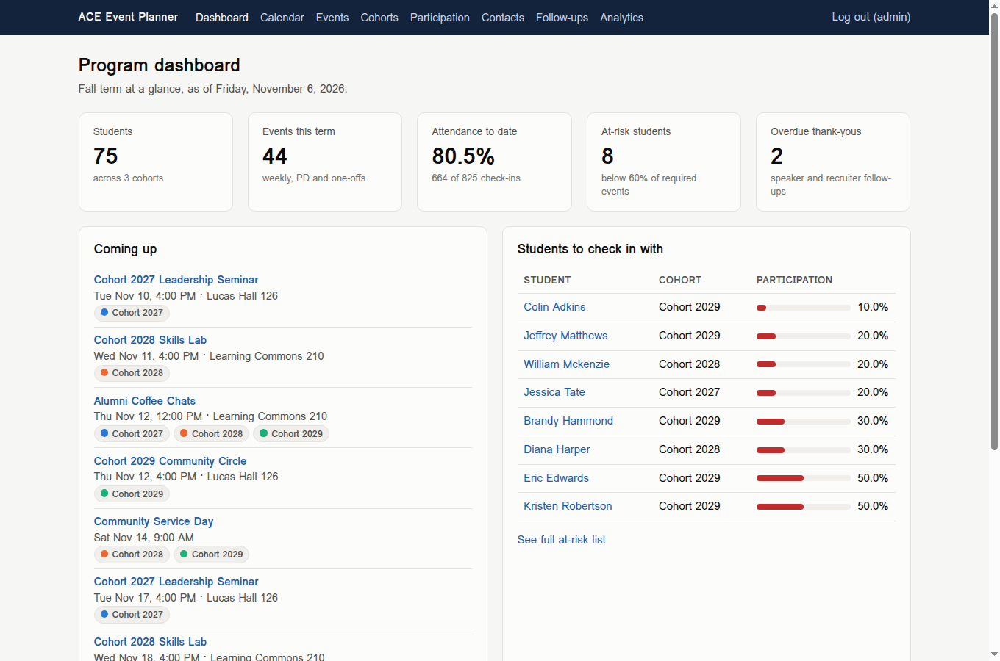
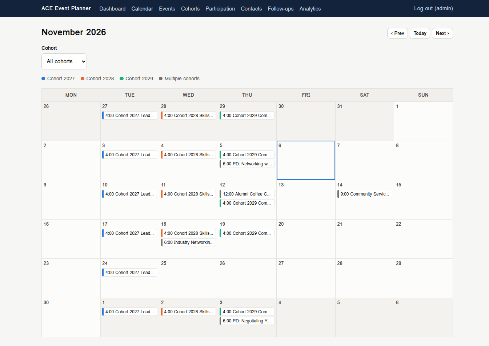
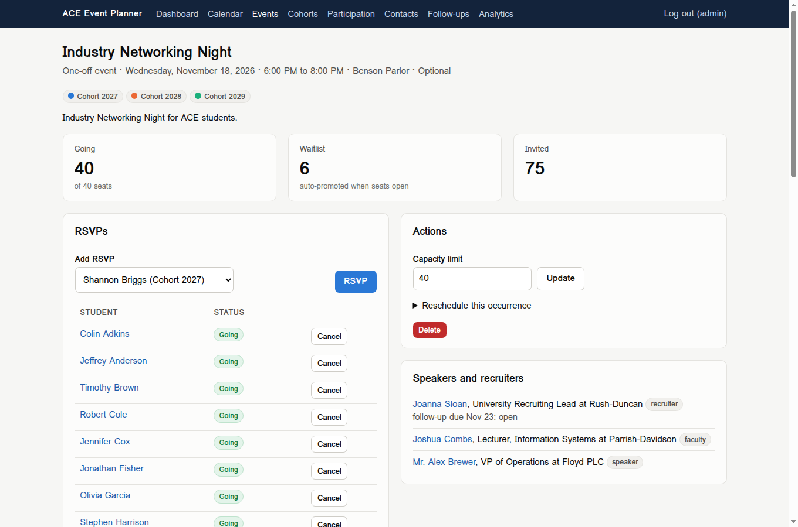
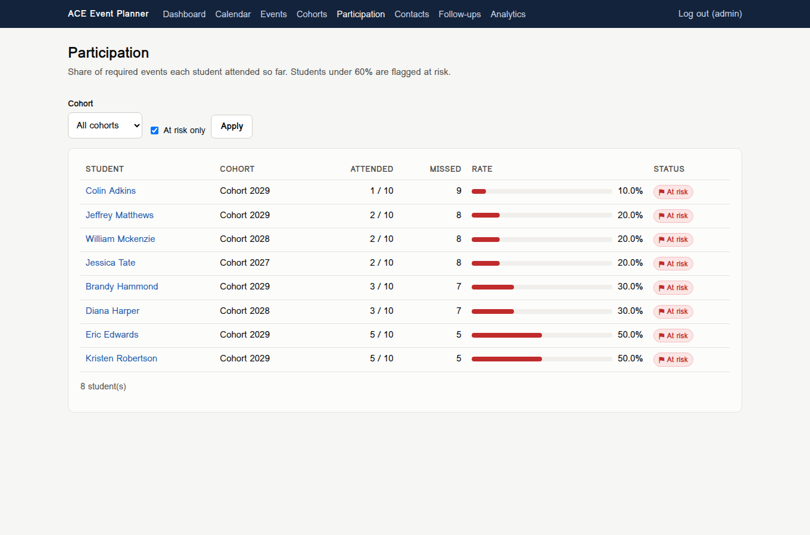
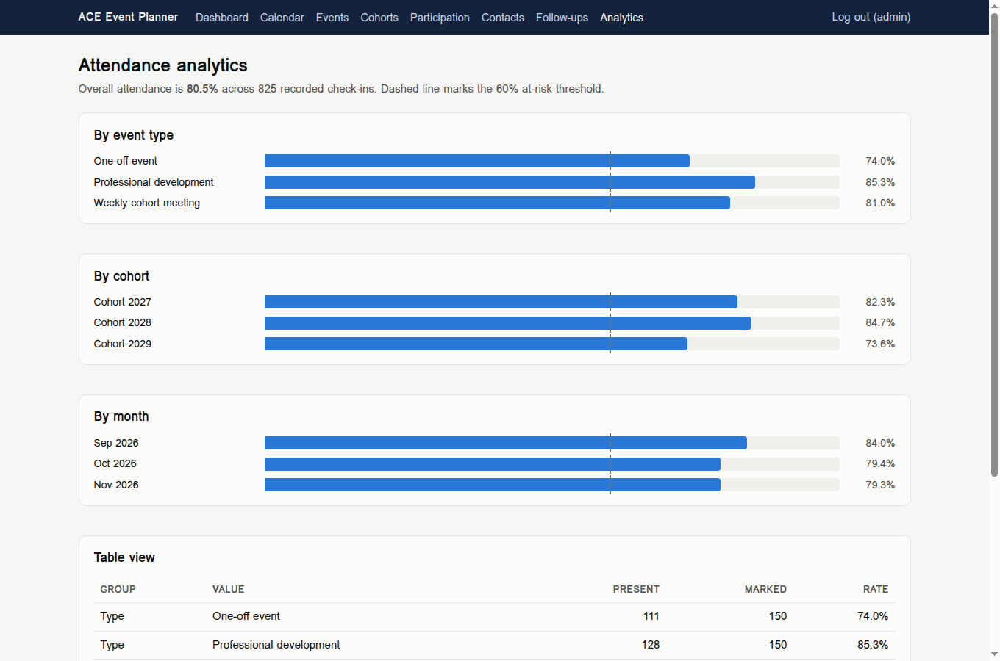
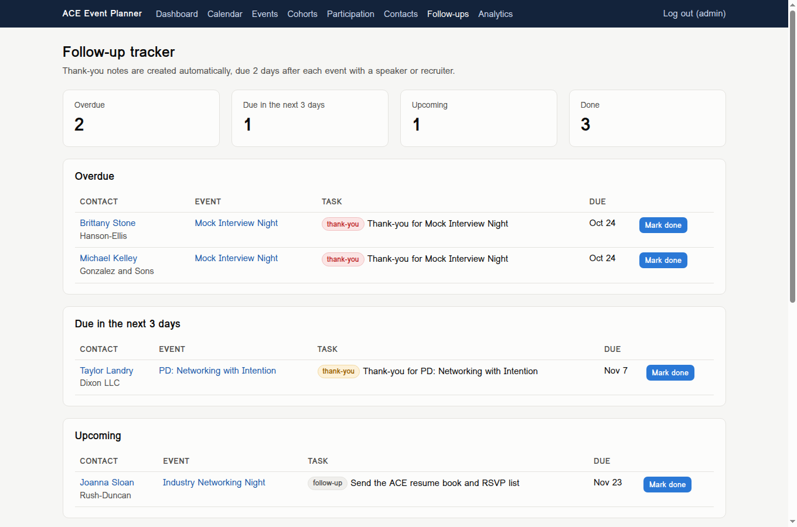

# ACE Cohort Event Planner

A Flask web app for running the event calendar of a cohort-based student leadership program: 3 cohorts, 75+ students, weekly meetings, monthly professional development, and one-off events with speakers and recruiters.

Built as a portfolio project modeled on the ACE program at Santa Clara University, where I work as a Program Assistant. **All data is synthetic** (generated with Faker under a fixed seed). No real students, speakers, or recruiters appear anywhere.



## The problem

Running events for three cohorts means juggling several spreadsheets at once: a room booking sheet, an RSVP form per event, a sign-in sheet that has to be typed up afterward, and a running list of speakers who still need a thank-you note. Each one answers a different question, and nobody can easily answer the question that matters most to staff: **which students are quietly falling behind on required events?**

This app puts scheduling, RSVPs, attendance, and follow-ups in one place so that question has an answer on the dashboard every morning.

## Features

| Area | What it does |
|---|---|
| **Cohorts and students** | 3 cohorts of 25 students, each with a roster, participation rates, and a color used across the app. |
| **Recurring events** | Create a whole series from an RRULE-style rule: `FREQ=WEEKLY;BYDAY=TU;UNTIL=20261208` for weekly meetings or `FREQ=MONTHLY;BYDAY=1TH;COUNT=3` for "first Thursday" PD workshops. Skip dates (Thanksgiving) are supported. |
| **Conflict detection** | Every occurrence is checked before anything is saved. Two events can't share a room at the same time, and a cohort can't be booked into two events at once. Back-to-back events are allowed. A conflict on week 7 blocks the whole series instead of leaving weeks 1 to 6 half-created. Staff can override on purpose. |
| **RSVPs with a waitlist** | Seats are the smaller of the event's limit and the room's capacity. Extra RSVPs join a first-come waitlist. When a student cancels, the next person is promoted automatically. Raising capacity promotes as many as now fit; lowering it never bumps anyone who already has a seat. |
| **Attendance** | A check-off sheet per event, pre-filled from RSVPs. Re-marking overwrites, so mistakes can be fixed. |
| **At-risk flags** | Each student's rate is required events attended divided by required events held for their cohort. Below 60% is flagged. Optional events never hurt anyone. |
| **Speaker and recruiter tracker** | Contacts linked to an event automatically get a thank-you task due 2 days after it ends. Tasks are grouped as overdue, due soon, upcoming, and done. Staff can log extra follow-ups too. |
| **Semester calendar** | A month grid filterable by cohort, color-coded by who is invited. |
| **.ics export** | Each cohort has a public calendar feed students can add to Google Calendar or Outlook. It contains event titles, times, and rooms only, no student data. |
| **Analytics** | Attendance rate by event type, cohort, and month, with a 60% reference line and a table view. |
| **Admin login** | Hashed passwords, session rotation on login, CSRF protection on every form, and no redirects to outside sites after login. |

| Calendar | Event with waitlist |
|---|---|
|  |  |

| At-risk students | Analytics |
|---|---|
|  |  |



## Architecture

The business rules live in plain Python modules with no Flask imports, so they can be unit tested directly. Views only parse input, call one of those modules, and render a template.

```
ace_planner/
  __init__.py       App factory, config, app clock (ACE_NOW)
  models.py         SQLAlchemy models: Cohort, Student, Room, Event, RSVP, Attendance, Contact, FollowUp, Admin
  recurrence.py     RRULE subset parser and expander (weekly BYDAY, monthly 1TH / -1FR, COUNT, UNTIL, skip dates)
  scheduling.py     Event validation, room and cohort conflict detection, series create, reschedule, delete
  rsvp.py           Capacity, waitlist ordering, auto-promotion
  participation.py  Attendance marking, participation rates, at-risk flags (two aggregate queries for the roster)
  followups.py      Thank-you generation and status buckets
  analytics.py      Attendance rates by type, cohort, and month
  calendar_view.py  Month grid helpers
  ics.py            RFC 5545 export with escaping, line folding, and a Pacific time zone block
  forms.py          Pure form parsing helpers
  security.py       Login, CSRF, safe redirect checks
  views.py          Routes (thin)
  seed.py           Deterministic synthetic Fall 2026 term
tests/              pytest suite (138 tests)
```

Data model in one sentence: an **Event** targets one or more **Cohorts**, may use a **Room** and feature **Contacts**; **Students** belong to a cohort and have an **RSVP** and an **Attendance** row per event; **FollowUps** link a contact to an event.

## Run it locally

Requires Python 3.12.

```bash
python3 -m venv .venv
source .venv/bin/activate
pip install -r requirements.txt

flask --app ace_planner seed            # 3 cohorts, 75 students, Fall 2026 term
export ACE_NOW=2026-11-06T09:00         # optional: view the term mid-quarter
flask --app ace_planner run
```

Open http://127.0.0.1:5000 and sign in with `admin` / `ace-demo-2026` (demo only; set `ACE_ADMIN_USER` and `ACE_ADMIN_PASSWORD` before seeding to change it). Set `SECRET_KEY` for anything beyond local use. Use `flask --app ace_planner seed --reset` to rebuild the data.

`ACE_NOW` pins the app's clock. The seed data covers September 21 to December 11, 2026, so pinning the clock to early November shows past attendance, at-risk students, overdue thank-yous, and upcoming RSVPs all at once.

### What the seed contains

- 3 cohorts (Cohort 2027, 2028, 2029) with 25 students each and a mix of majors
- Weekly meetings for each cohort on its own weekday, skipping Thanksgiving week
- Monthly PD workshops on the first Thursday of October, November, and December
- 7 one-off events, including an oversubscribed Industry Networking Night (40 seats, 6 on the waitlist)
- 8 speakers, recruiters, alumni, and faculty contacts with thank-you tasks in every state
- Attendance for every past event, driven by a per-student engagement level so about 1 in 9 students lands below 60%

## Tests

```bash
pytest -q        # 138 tests
ruff check .
```

The suite covers:

- **Recurrence:** weekly multi-day rules, intervals, first and last weekday of the month, skipped short months, skip dates, and 14 kinds of invalid rules
- **Scheduling:** half-open overlap, room vs cohort conflicts, all-or-nothing series creation, overrides, reschedule, delete "this and future"
- **RSVP:** capacity, waitlist order, promotion on cancel, rejoining goes to the back, capacity changes, closed after start, uninvited cohorts
- **Participation:** exactly 60% is not at risk, optional and future events ignored, unmarked events count as missed, multi-cohort events counted once
- **Follow-ups, .ics, calendar, analytics, form parsing, safe redirects**
- **Routes:** every page requires login, every page renders, CSRF (including empty tokens), RSVP and attendance flows end to end, 404s
- **Seed:** counts, determinism, PD on first Thursdays, no conflicts anywhere in the generated term

## Tech stack

Python 3.12, Flask 3, SQLAlchemy 2 with Flask-SQLAlchemy, SQLite, Jinja2, plain CSS (no JavaScript framework), Faker, pytest, ruff.

## What I learned

- **Write the rules down before the screens.** Questions like "does exactly 60% count as at risk?" or "if someone cancels and RSVPs again, do they keep their place?" sound small, but they are the policy. Writing each one as a test forced a decision, and the test now documents it.
- **All-or-nothing beats partial success.** A recurring series that saves week by week and stops at the first conflict leaves a half-built mess for the admin to clean up. Checking every occurrence first and then saving once is how real scheduling tools behave, and it is what staff expect.
- **Define the metric carefully.** "Attendance rate" can mean several things. I chose required events held for the student's own cohort, counted after they end, with unmarked events counted as missed. That choice changes who gets flagged, so it is spelled out on the page.
- **Small security details matter.** Writing tests for the login flow caught a real bug: an empty CSRF token matched an empty session and slipped through. A one-line fix, but I would not have found it by clicking around.
- **Separate logic from UI.** Keeping the rules in plain Python modules made 138 tests run in seconds and kept the Flask views short enough to read in one screen.

## License

MIT. See [LICENSE](LICENSE).
